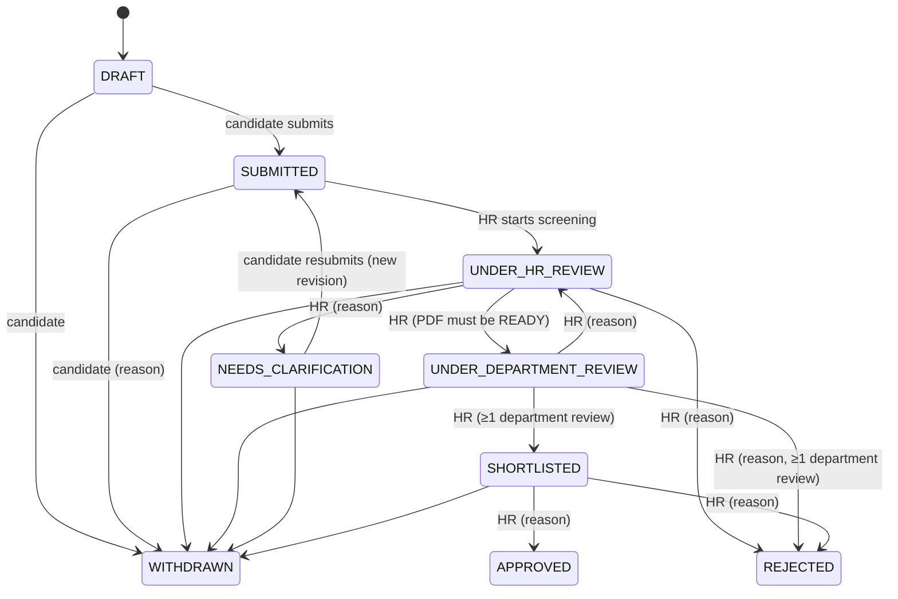

# Application workflow

Implemented in `app/modules/applications/workflow.ts` (pure) and enforced by `service.server.ts`.
**This model is an initial proposal and must be reviewed against college policy before production.**

Every transition: current state re-checked inside the transaction (`updateMany where status = current`), actor permission and scope verified, reason validated where required, history row + audit event written, candidate notification queued via the outbox only for decision states.

## Document processing status (separate)

`NOT_STARTED → QUEUED → PROCESSING → READY | FAILED`. The spec's suggested `PROCESSING_DOCUMENTS` / `DOCUMENTS_READY` recruitment states were deliberately replaced by this separate field (ADR 0004), so a failed PDF job never changes or corrupts the recruitment state.

## Open policy decisions

- Who may record the final APPROVED decision (currently HR officer; may need HOD/committee).
- Whether withdrawal after shortlisting is allowed; whether one application per vacancy is correct.
- Whether clarification resubmission is allowed after the closing date (currently allowed).
