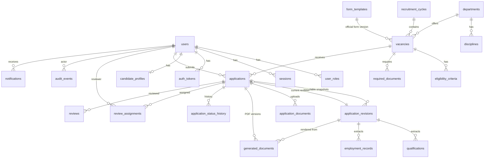

# Entity-relationship diagram

Source of truth: `prisma/schema.prisma`. All ids are UUIDs; `applications.referenceNo` is the human-readable id.

`outbox_events` and `reference_counters` are infrastructure tables without foreign keys.

## Integrity rules

- Unique: `users.email`, `(candidateId, vacancyId)`, `(applicationId, revisionNo)`, `(code, version)` on templates, `(revisionId, kind, version)` on generated documents, `(applicationId, reviewerId, stage)` on assignments.
- CHECK: date windows, positive sizes/posts, review score 0–100, lower-case e-mail, submitted applications must have reference + revision.
- Triggers: append-only `application_revisions`, `audit_events`, `application_status_history`, `reviews`, `qualifications`, `employment_records`; `application_documents` content immutable and undeletable; `generated_documents` write-once once READY.
- Indexes: vacancy+status, status+submittedAt, submittedAt, department, candidate name, audit entity/actor/time.
- Answers are stored as versioned JSONB (`revision.answers`, keyed by form-definition field keys) with qualifications and employment normalised for filtering (ADR 0003).
